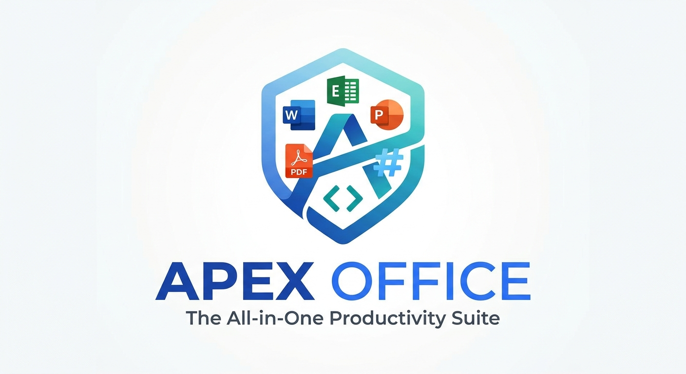

<p align="center">
  
</p>

<p align="center"><b>Documents, spreadsheets, presentations, PDF, Markdown and HTML in one desktop app.</b><br>
Real Word, Excel and PowerPoint files, opened and saved on your own computer. No account, no cloud, no AI.</p>

<p align="center">
  <a href="LICENSE"></a>
  
</p>

<p align="center">
  <a href="#install"><b>Install</b></a> ·
  <a href="#the-apps"><b>The apps</b></a> ·
  <a href="#pdf"><b>PDF</b></a> ·
  <a href="#explorer-thumbnails"><b>Thumbnails</b></a> ·
  <a href="#command-line"><b>Command line</b></a> ·
  <a href="#build-from-source"><b>Build</b></a> ·
  <a href="PRIVACY.md"><b>Privacy</b></a>
</p>

Apex Office is a free, open-source office suite for Windows. It opens and saves
native `.docx`, `.xlsx` and `.pptx` files, edits PDF, Markdown and HTML, and keeps
everything on your machine: documents never leave it, there is no sign-in, and
nothing in the program talks to an AI service.

- **Real formats, byte-preserving.** Only what you edit is rewritten. Everything
  else in the file survives byte-for-byte, so documents keep working in Word,
  Excel and PowerPoint.
- **Local by design.** Files open, edit, save and convert on your computer. PDF to
  Word, Excel and PowerPoint, Markdown to Word and HTML to Word all run
  on-device. There is no usage reporting.
- **Find files by what they say.** The home screen searches the names, folders and
  full text of your documents, spreadsheets, presentations, PDFs, Markdown and
  HTML files from a local index, CJK included.
- **Looks right in Explorer.** Documents, workbooks, slide decks, PDFs, Markdown
  and HTML files show their first page as the thumbnail, with a small Apex Office
  badge in the corner. See [Explorer thumbnails](#explorer-thumbnails).
- **Scriptable.** A command line, `apexoffice`, converts, renders and edits the same
  files without opening a window.

ODF files (`.odt`, `.ods`, `.odp` and the `.ott`/`.ots`/`.otp` templates) open as
editable OOXML copies, and so do legacy Word `.doc`/`.dot` files and Hancom
documents (`.hwp`, `.hwpx`). Imports are open-only: saving writes OOXML, never the
source format.

## Install

1. Download `ApexOffice-Setup-<version>.exe` from the
   [Releases](https://github.com/bharadfi/genoffice/releases) page.
2. Run it and choose where to install (the default is your user profile; no
   administrator rights are needed).
3. Start **Apex Office** from the Start menu, or just double-click a document.

Requirements: Windows 10 or 11, 64-bit.

Uninstall from **Settings → Apps**, or with any uninstaller such as Revo: the
uninstaller removes the program, its file associations, its Explorer thumbnail
registration and its entry on your `PATH`.

## The apps

| App | Opens and saves | Highlights |
| --- | --- | --- |
| **Docs** | `.docx` | Word's layout and line metrics, styles, comments, tracked changes, equations, ink, content controls, mail merge, headers and footers |
| **Sheets** | `.xlsx`, `.csv`, `.tsv` | A Rust `.xlsx` engine, formulas, charts, pivot tables, slicers, conditional formatting, formula tracing |
| **Slides** | `.pptx` | Masters and layouts, smart guides, non-destructive cropping, 3D models, slide-show recording with narration |
| **PDF** | `.pdf` | Text editing in place, forms, signatures, OCR, redaction, page tools, PDF → Word / Excel / PowerPoint |
| **Markdown** | `.md` | Live preview, outline, backlinks, tags, export to Word, PDF, HTML and images |
| **HTML** | `.html` | Visual editing with a live preview, split and source views, export to Word |

All six live in one window with tabs, a home screen with recent and starred files,
folders, and a full-text file search.

## PDF

The PDF app is the most extended part of the suite.

- **Edit text in place**, including pages that are only a picture: scanned pages
  are read with built-in OCR (Tesseract, no download), the recognised lines can be
  clicked and retyped, and the new text is drawn in the closest matching face over a
  box in the page's own colour.
- **Digital signatures that tell the truth.** Every signature box shows a badge
  for its verdict (valid, invalid or not verified) and keeps one badge, on screen and
  in print. A trusted-certificate list of your own decides what counts as trusted,
  and a certified document says who certified it.
- **Compare** two documents with a chosen page range for each.
- **Read Out Loud** with the voice built into Windows: a page, or from here to the end,
  with pause and resume.
- **Page labels** (`i, ii, iii`, `A-1`, `A-2`), applied after deleting and reordering.
- **Scan to PDF** from a scanner, one page after another into a new file.
- **Print and Save as PDF.** Printing sends the real file, so text stays text. *Save
  as PDF (built in)* writes a new PDF with its text kept as whole lines; a PDF printer
  driver redraws every line letter by letter.
- **Remove hidden information**: document information, attached files, JavaScript,
  comments, thumbnails, and optionally bookmarks and links, written to a clean copy.
- **Accessibility check** for tags, language, title, figure alternate text, field
  descriptions, tab order and bookmarks, with a fix for what can be fixed.
- **Security properties** in Properties: encryption method, permissions, signatures,
  scripts and attached files, as the file states them.
- **PDF → Word** that rebuilds paragraphs, tables, lists and fonts rather than
  placing every line in a box.

## Explorer thumbnails

The installer registers a small Windows shell extension (`apex_thumbs.dll`). When
Explorer asks for a thumbnail it hands the extension the file; the extension asks the
program's own command line to draw page 1 and shrinks the picture to fit, with the
Apex Office badge in the bottom right corner (the way other programs mark their
files). It covers `.docx`, `.xlsx`, `.xlsm`, `.pptx`, `.pdf`, `.md`, `.markdown`,
`.html` and `.htm`.

- A file that cannot be drawn (a password-protected document, or a very old binary
  format) gets the Apex Office tile instead of a page.
- Drawing happens in a separate, low-priority process with a time limit, so a damaged
  file can only stop that process, never Explorer.
- Windows keeps thumbnails in a cache. If you installed over an older build and see old
  pictures, clear it with *Disk Cleanup → Thumbnails*.

## Command line

The installer puts `apexoffice` on your `PATH` (open a new terminal after installing).

```text
apexoffice info <file>                    what a file is and holds
apexoffice convert <file> --to <format>   docx, xlsx, pptx, pdf, md, html and more
apexoffice create <kind> <file>           a new document, workbook or deck
apexoffice render <file> --page 1         a PNG of a page (add --scale for size)
apexoffice docs | sheet | slides ...      read and edit with ops, as JSON
apexoffice merge <template> <data>        mail merge
apexoffice pdf ...                        page tools for PDFs
apexoffice open <file>                    open a file in the running app
apexoffice capabilities                   whether the app is installed
```

Every command accepts `--json`. `apexoffice --help` lists them all.

## Build from source

Requirements: Node.js 22.12 or newer, Rust (for the `.xlsx` engine and the thumbnail
extension), and on Windows the Windows SDK.

```bash
npm ci
npm run build:all                      # every app, the command line and the shell
npm run dist:win -w @genoffice/shell   # the installer, in apps/shell/release
```

The thumbnail extension (`apps/shell/native/apex-thumbs`) is built with `cargo
build --release` by the packaging step when it is missing.

## Where it comes from

Apex Office is inspired by and forked from the open-source project GenOffice, and
shares its engines for Word, Excel, PowerPoint, PDF, Markdown and HTML files. It
differs in these ways:

- It is a Windows application. The macOS and Linux packaging was dropped.
- There is no AI assistant, no cloud account, no project sync and no external-agent
  integration. The AI panels, the "Ask" screen, the model settings, the MCP server
  and the agent skills are gone, and the command line has no agent commands.
- There is no usage reporting and no automatic update feed.
- The PDF app gained the features listed under [PDF](#pdf), including built-in OCR,
  editing of scanned text, signature verdict badges, Read Out Loud, Scan to PDF,
  page labels, hidden-information removal, an accessibility check and security
  properties.
- The installer registers Explorer thumbnails with the Apex Office badge and puts
  the `apexoffice` command on your `PATH`.

## License

Apache License 2.0, see [LICENSE](LICENSE). The copyright and attribution notices of
the project this one is forked from are kept in [NOTICE](NOTICE), and the licenses of
bundled components are listed in `THIRD-PARTY-NOTICES.txt`, which the packaging step
generates and ships with the installer.
